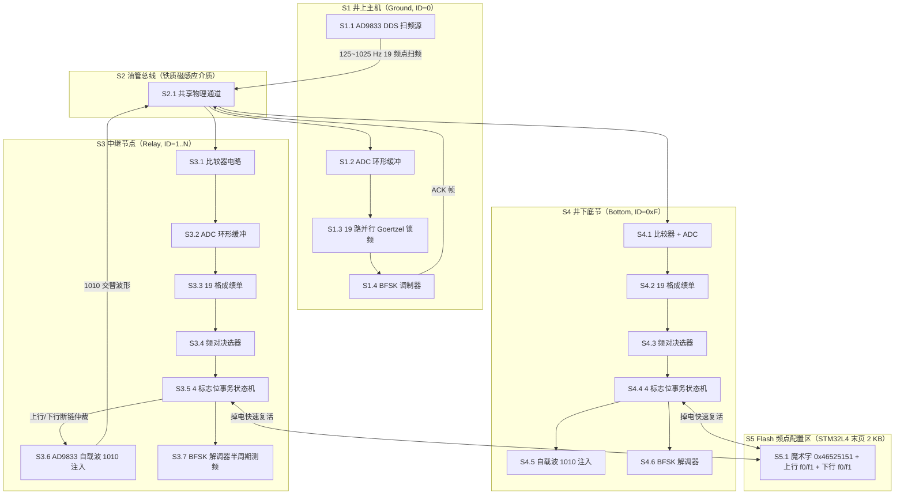
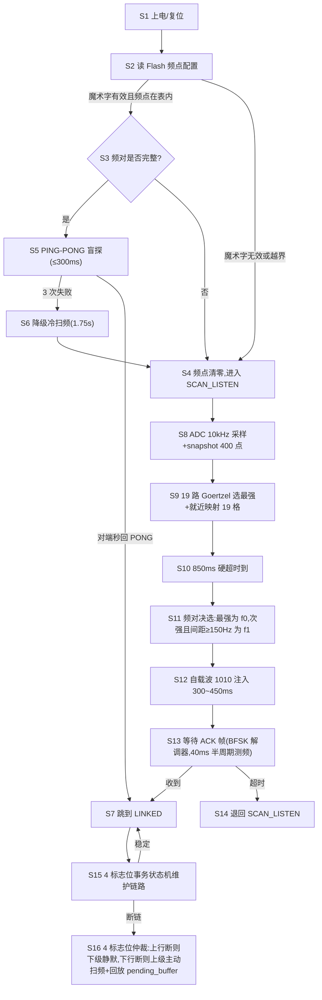

# 技术交底书

**案件名称**：一种面向油管多级中继 BFSK 通信的冷启动扫频选频与频对通知方法及系统

**技术联系人**：
- 姓名：[待填写]
- 电话：[待填写]
- 邮箱：[待填写]

**专利类型**：发明

---

## 注意事项

（1）交底书应使代理人能看懂，尤其是背景技术和详细技术方案，一定要写得全面、清楚、完整；
（2）技术的公开程度，应以本领域普通技术人员不需付出创造性劳动即可进行实施为准。
（3）在与代理人沟通时，对于代理人咨询的技术问题，应给予回答并认真讲解，并且按要求及时正确地补充相应技术材料。

---

## 一、介绍相关技术背景，描述与本发明技术最相近的现有技术，并说明该现有技术存在的缺点

### 1.1 现有技术

#### 检索说明

在国家知识产权局专利公布公告系统及 Google Patents 中，以「油管 磁环 通信 扫频」「多中继 BFSK 自载波回传」「Goertzel 频点表 滑动窗 决策」等为检索词进行检索；部分条目的公开文本与著录项以 Google Patents 页面复核。本次轻量查新因本机 Python 工具链不可用，已按 §B 降级至 WebSearch，证据级别为摘要级。

#### 按技术方向分类的现有技术

**A. 扫频+选频骨架（D1 群，最接近本案的子模块）**

- **D1 CN104158605A《一种基于 pwm 码实现无线携能通信频率自适应的方法》**（来源链接：https://patents.google.com/patent/CN104158605A/zh）：方案要点为发送端 MCU 控制 DDS 扫频，比较电路采样后由 MCU 测量 PWM 占空比得到幅频曲线，再以抽样式峰值检测找出谐振点，存 RAM 备用。适用于无线携能通信 ICPT 场景的距离/姿态自适应。**摘要级判断（公开文本未通读）**。
- **D6 CN101325527A《基于 fsk 调制方式的传感器无线传输系统》**（来源链接：https://patents.google.com/patent/CN101325527A/zh）：方案要点为单片机+FSK 调制解调 + RS485 总线轮询；强调 DDS 线性扫频消除 FSK 瞬时相位拐点以加快频谱衰减。**摘要级判断**。

**B. 多节点动态选频（远领域参考）**

- **D2 CN119628681A《一种基于 TDMA 系统实现无中心自组网动态选频的方法》**（来源链接：https://max.book118.com/html/2026/0708/6132221023012155.shtm）：方案要点为 TDMA 自组网上电后扫描频点存底噪，节点发现底噪异常时按底噪信息寻找并切换至最优频点；融合频率跳变与 DFS 技术，去除主从概念。**摘要级判断（PDF 仅摘要可见）**。
- **D4 CN114786231B《无线 mesh 自组网的通信方法》**（来源链接：https://patents.google.com/patent/CN114786231B/zh）：方案要点为基于拓扑矩阵做前向/反向搜索求源到目标最小跳数中继路径。属路由层方案。**摘要级判断**。

**C. 替代传输介质**

- **D5 CN115680632A《一种井下微电流信号无线上传方法及装置》**（来源链接：https://patents.google.com/patent/CN115680632A/zh）：方案要点为以油管+套管为载流导体、地面端检测微电流；属电流载波方案，与本案的磁环感应 BFSK 非同技术路线。**摘要级判断**。

**D. 频率合成/FSK 调制**

- **D3 CN104935090A《电能无线传输中基于频率分裂的电能和信号同步传输方法》**（来源链接：https://patents.google.com/patent/CN104935090A/zh）：方案要点为利用电磁耦合系统过耦合时的频率分裂特性，把两个自治稳定频率作为 2FSK 载波，副边锁相鉴频解调。属调制技术层方案。**摘要级判断**。

**E. 跳频同步**

- **D7 CN101753201A《一种高速跳频无人机数据链同步方法》**（来源链接：https://patents.google.com/patent/CN101753201A/zh）：方案要点为同步字头法 + 直接序列扩频，接收机对特征码相关运算后用超前滞后法调整跳频切换位置。属"已知同步头"前提的跳频同步方案，与本案的"全无同步"冷启动不可类比。**摘要级判断**。

#### 选定 D1 的理由

本案要解决的核心问题是"井下油管多级中继磁环 BFSK 通信在双方既无数字信道、又无时钟同步的冷启动场景下，如何可靠完成扫频选频与频对回传"。D1 在"通过扫频把物理信道最优载波频率识别出来"这一**子模块**层与本案手段骨架最近——都是 DDS 主动扫频、采样幅频、挑出频点存表——故选为逐特征主表的出发点；本案整体方案（自载波 1010 频对回传 + 多中继总线抗串扰 + 4 标志位断链仲裁 + Flash 盲探重连）在上述任一篇中均未见到完整对应，**D1 公开文本未通读，下述区别为摘要级判断**。

#### 逐特征比对表（主表对 D1；D2 在"有组合风险"行补行）

| 编号 | 对比点 | 对比文献 | D1 / D2 怎么做 | 本案怎么做 |
|------|--------|----------|----------------|------------|
| F1 | 选频机制 | D1 | 抽样式峰值检测，把全部谐振点都存入 RAM 作为"载波频率表" | 19 格独立成绩单（每格只增不淘汰）+ 频差下限 ≥150 Hz 决选，仅挑出 f0、f1 一对作为 BFSK 通信频对 |
| F2 | 冷启动扫频门限 | D1 | 仅做幅值抽样式峰值检测，单一物理量 | 三重校验：幅值 ≥ 2×NoiseFloor + 相邻波峰一致性 ≤ 15% + 标称频点 ±15 Hz 就近映射 |
| F3 | 滑动分析节奏 | D1 | 扫完一整段幅频曲线再统一处理 | 40 ms 分析窗口 + 10 ms 滑动步长（75% 重叠），每个发射频点被覆盖 3~4 次 |
| F4 | 频对回传机制 | D1 | 无（单跳点对点） | 自载波交替回显：接收方直接以 (f0, f1) 作载波 0xAA 交替注入，发射方用 19 路并行 Goertzel 锁定 |
| F5 | 多中继总线抗串扰 | D1 | 不涉及 | 静态 ID 硬分配时窗 TDMA（窗口 1~4）+ 总线侦听主动退避 + 850 ms 末"≥5 个有效频点"真扫频判决 |
| F6 | 断链角色仲裁 | D1 | 不涉及 | 4 标志位事务状态机 + 64 B pending_buffer：上行断链下级静默监听、下行断链上级主动扫频并回放缓存命令 |
| F7 | 掉电恢复 | D1 | 不涉及 | Flash 16 字节备份（魔术字 0x46525151"FRQQ"+ 4 频点），上电优先 PING-PONG 盲探 < 300 ms，3 次失败才降级 1.75 s 冷扫频 |
| F8 | 解调双重保底 | D2 | D2 关注 DFS 切频，不做物理层时序对齐 | 40 ms 时间窗口到期 + 频率切换检测（时序同步触发器）双机制，解决 1025 Hz 高频周期数判据不可靠问题 |

#### 特征一览（后文简称）

- F1 独立成绩单 + 频差下限决选
- F2 三重门限校验（幅值 + 波峰一致 + 就近映射）
- F3 40 ms 窗 75% 高重叠滑动
- F4 自载波 1010 频对回显
- F5 静态 ID 时窗 + 总线侦听 + 真扫频门限
- F6 4 标志位事务状态机断链仲裁
- F7 Flash 频点缓存 + PING-PONG 盲探
- F8 40 ms 窗口 + 切换检测双重保底解调

### 1.2 现有技术存在的缺点

- D1 仅做单跳点对点扫频选载波，既未考虑多节点共享总线带来的串扰问题，也未考虑"无数字信道下如何把选定的频对告诉对方"这一**反向通信**问题；其结果是一旦节点数 ≥2，必发生碰撞。
- D1 与 D6 都没有"频对回传"机制：扫频只是为发射端找最佳载波，不知道接收端实际选中了哪两个频点，二者无法闭环建链。
- D2 虽考虑多节点，但只关注"频点底噪差"这一静态维度，未区分"真扫频"与"节点间数据通信"两类信号——当一个 1010 交替波形在总线上传播时，下游节点若不做物理特征差异校验，就会被误判为"上级在扫频"而误触发整网级联扫频。
- 上述现有技术都未在物理层提供"无控制通道时如何分时发言"的硬时窗机制；常规 TDMA 假设"已有同步"，无法套用到"双方时钟无任何关联"的井下冷启动场景。
- 上述现有技术都未涉及"上行/下行任意方向断链时节点如何自决角色"——常规做法是两端都重扫或都等待，本案依靠 4 标志位事务上下文做到"上行断链则下级静默、下行断链则上级主动扫频并回放缓存命令"，实现恶劣信道下的数据零丢失。

## 二、针对上述缺点，说明本发明所要解决的技术问题

如何在油管多级中继磁环 BFSK 通信双方既无数字信道又无时钟同步的冷启动场景下，仅凭物理正弦波即可靠完成"信道衰减最小的两个载波频点识别 + 把频对可靠通知对方 + 多节点共享总线时不发生碰撞 + 任意单方向断链时自动仲裁出谁扫频谁监听 + 掉电后优先以低代价复活"这一整套建链任务，并在井下强衰减、电池供电、节点时钟无关联的约束下，保证全流程单次握手在 1.75 秒以内完成、扫频阶段单次会话不超过 850 毫秒。

## 三、本发明技术方案的详细阐述

### 3.1 背景（场景与参与者）

本发明面向"井下油管柱多级中继磁环感应 BFSK 通信系统"。系统的物理介质是一根连续的铁质油管，沿油管每隔若干米套一个磁环（井下中继节点、底节节点各一个磁环；地面井上主机一侧同样有一个磁环）。每个磁环既是信号发射端也是信号接收端：发射时由 AD9833 DDS 经功率放大器向磁环注入正弦波（BFSK 调制或扫频载波），接收时由 STM32L4 ADC 经比较器电路采集磁环感应电压。系统的典型部署包括三类参与者：

- **井上主机（Ground Node）**：硬地址 ID = 0；其上行经串口直连上位机，永不进 SCAN_LISTEN。
- **中继节点（Relay Node）**：硬地址 ID = 1..N；既有上级又有下级。
- **井下底节节点（Bottom Node）**：硬地址 ID = 0xF；只有上级没有下级。

系统的"扫频启动协议"指双方在**未建链**时仅靠物理正弦波完成四件事：判断对方是否在扫频、判断扫频何时结束、确认当前测到的是哪个频点、把选定的最优频对告诉对方。本发明的高频术语在全文统一使用如下场景定义：

- **扫频方 / 被扫方**：扫频方为当前正在主动发射 19 频点扫频波的节点；被扫方为正在接收并填成绩单的节点。同一对节点在不同阶段角色会互换。
- **成绩单（19 格幅值表）**：被扫方在单片机内存中开辟的 19 元素幅值记录数组，每格对应 125 Hz ~ 1025 Hz 共 19 个标称频点，**只记录，不淘汰**。
- **频对 (f0, f1)**：扫频结束后从成绩单决选出的两个频点，用于后续 BFSK 调制解调，约定 f0 < f1 且 |f1 - f0| ≥ 150 Hz。
- **1010 波形（自载波回显）**：被扫方在扫频结束后，把选出的 (f0, f1) 作为载波、以标准交替方波（数字特征码 0xAA）反向注入油管所形成的物理信号。
- **4 标志位事务上下文**：每个节点本地维护的 `flag_rx_up / flag_fwd_dn / flag_rx_dn / flag_fwd_up` 共 4 个 1 bit 标志位 + 64 B `pending_buffer`，用于描述本节点当前事务闭环状态、驱动断链场景下的角色自发仲裁。

标题中的"冷启动"特指双方时钟无关联、无数字信道、无任何应用层协议可用的初始建链状态。

### 3.2 系统框图

### 3.3 模块功能说明

- **S1.1 AD9833 DDS 扫频源**：在 SCAN 状态期间，按 125 Hz 起、50 Hz 步进、1025 Hz 终的固定表逐频点切换，每个频点驻留 40 ms，总时长 19×40 = 760 ms。
- **S1.2 / S3.2 / S4.1 ADC 环形缓冲**：以 TIM6 TRGO 触发 ADC1，DMA 半传输/全传输双中断维护一个 2 的幂次方大小（512 点 = 51.2 ms 余量）的环形缓冲；对外暴露 `snapshot(400 点)` 和 `read(倒数 N 点)` 两个原语。
- **S1.3 19 路并行 Goertzel 锁频**：井上主机收到被扫方回传的 1010 波形时，并行启动 19 个 Goertzel 实例（每个实例只关心一个标称频点），从中识别 f0、f1 交替的窄带能量柱。
- **S3.3 / S4.2 19 格成绩单**：每个频点独立打分，每 10 ms 一次解算后只与该格历史最大幅值比较并保留较大者。
- **S3.4 / S4.3 频对决选器**：在 850 ms 会话硬超时到来时遍历成绩单，筛有效频点（amp > noise_floor + 50），挑最强为 f0；筛剩余中 amp 最大且与 f0 间距 ≥ 150 Hz 的为 f1。
- **S3.5 / S4.4 4 标志位事务状态机**：见 §3.4.2 流程主表 S11~S13。
- **S3.6 / S4.5 自载波 1010 注入**：把 (f0, f1) 写入 AD9833 REG0/REG1，以 PRE_BFSK_BIT_PERIOD_MS = 40 ms 周期交替 `bsw_ad9833_select` 两个寄存器，0xAA 特征序列在油管上形成。
- **S3.7 / S4.6 BFSK 解调器**：TIM1 CH1 上升沿 + CH2 下降沿成对捕获，按半周期测频 + 对称性校验判别 f0/f1，落到 40 ms 时间窗，详见 §3.4.2 S9。
- **S5.1 Flash 频点配置区**：STM32L4 最后一页 2 KB；存 `magic 0x46525151 "FRQQ" + uplink_f0/f1 + downlink_f0/f1 + reserved`，按 8 字节对齐分两次 `FLASH_TYPEPROGRAM_DOUBLEWORD` 写入。

### 3.4 系统流程说明

#### 3.4.1 符号与公式

| 符号 | 含义 | 量纲 / 取值 |
|------|------|-------------|
| \(f_s\) | ADC 采样率 | 10000 Hz |
| \(N_w\) | 扫频分析窗口长度 | 400 点 = 40 ms |
| \(T_s\) | 扫频分析窗滑动步长 | 10 ms |
| \(R\) | 单频点驻留时长 | 40 ms |
| \(N_f\) | 标称扫频频点数 | 19 |
| \(f_{\text{start}}\) | 起始频点 | 125 Hz |
| \(\Delta f\) | 频点步进 | 50 Hz |
| \(T_{\text{wd}}\) | 会话硬超时 | 850 ms |
| \(N_{\text{th}}\) | 真扫频门限（有效频点数） | ≥ 5 |
| \(G_{\min}\) | 频差下限 | 150 Hz |
| \(T_{\text{ack}}\) | ACK 短帧持续 | ≈ 150 ms |
| \(T_{\text{slot}}\) | 静态 ID 时窗长度 | 600 ms |
| \(K_{\text{nf}}\) | 底噪系数（倍） | 2（用于 F2 幅值门限） |
| \(\delta\) | 标称频点就近容差 | ±15 Hz |
| \(P_{n}\) | 静态底噪功率 | 工程实测更新 |
| \(A_{\max}\) | 40 ms 窗内峰峰值 | 由 ADC 样本计算 |
| \(\sigma_{P}\) | 相邻波峰幅值相对偏差阈值 | 0.15 |
| \(k\) | Goertzel 归一化频率 bin | \(k = N_w \cdot f / f_s\) |
| \(\omega\) | 旋转角频率 | \(\omega = 2\pi k / N_w\) |
| \(s_0,s_1,s_2\) | Goertzel 二阶 IIR 状态量 | 浮点 |
| \(P_f\) | 单频点能量（功率） | \(P_f = \mathrm{Re}^2 + \mathrm{Im}^2\) |

**Goertzel 单频点能量递推式**（**S1.3 / S3.3**）：

\[
s_0[n] = x[n] + 2\cos(\omega)\, s_1[n-1] - s_2[n-1]
\]
\[
s_2[n] = s_1[n-1],\quad s_1[n] = s_0[n]
\]
\[
P_f = \bigl(s_1[N_w] - s_2[N_w]\cos\omega\bigr)^2 + \bigl(s_2[N_w]\sin\omega\bigr)^2
\]

**BFSK 半周期测频式**（**S3.7 / S4.6**）：

\[
\Delta t_{\text{half}} = t_{\text{rise2}} - t_{\text{rise1}} \big/ 2
\]
\[
f_{\text{est}} = f_{\text{clk}} / (2\,\Delta t_{\text{half}})
\]
其中 \(f_{\text{clk}} = 10\,\text{MHz}\)（TIM1 / 8 分频），完整周期由 CH1-CH2-CH1 三次捕获校验对称性（高半周期与低半周期之差 ≤ 完整周期的 25%）。

#### 3.4.2 流程主表

**S1~S16 步骤文字说明**：

- **S1 上电/复位**：节点初始化时钟、GPIO、DMA、TIM6、ADC、AD9833；初始化 `bsw_freq_storage` 与 19 格成绩单。
- **S2 读 Flash 频点配置**：从 STM32L4 最后一页 2 KB 读 16 字节结构；魔术字 0x46525151 + 范围 [100, 2000] Hz 通过 BSW 层校验后，由 APP 层再校验频点是否在 19 元素标称表内（容差 ±15 Hz）。
- **S3 频对是否完整**：上行 (f0, f1) 与下行 (f0, f1) 是否均有效。
- **S4 进入 SCAN_LISTEN**：以 10 kHz 持续采样，每 10 ms 取一次 40 ms 窗口进入 §3.4.2 S9。
- **S5 PING-PONG 盲探**：用 Flash 中的频对以短 BFSK 帧发 PING；下级 300 ms 内秒回 PONG 即跳 S7；失败 3 次才走 S6。
- **S6 降级冷扫频**：擦除 Flash → 启动 19 频点扫频（125~1025 Hz × 40 ms = 760 ms）→ 850 ms 硬超时到 → 进 S11。
- **S7 LINKED**：激活 BFSK 解调器 → `proto_rx_init` → 帧分发到 `app_frame_handler`。
- **S8 ADC 10 kHz 采样 + snapshot 400 点**：开 DMA + TIM6 → 40 ms 窗口按 10 ms 滑动（75% 重叠）。
- **S9 19 路 Goertzel 选最强 + 就近映射 19 格**：用 §3.4.1 Goertzel 公式对 19 个标称频点各算一次能量，能量超过 BSW_FREQ_ANALYZER_ENERGY_THRESHOLD 时把瞬时频率 f_calc = f_s / ΔN 与 19 元素标称表做 ±15 Hz 就近匹配，仅在匹配成功时把该格成绩单按"只增不淘汰"原则更新。
- **S10 850 ms 硬超时到**：在 `sweep_start_tick` 启动后的第 850 ms 无条件触发。
- **S11 频对决选**：遍历 19 格筛选有效频点（amp > noise_floor + 50），挑最强为 f0；挑剩余中 amp 最大且 |f1 - f0| ≥ 150 Hz 的为 f1。
- **S12 自载波 1010 注入**：把 (f0, f1) 写入 AD9833 REG0/REG1，以 40 ms 周期交替 `bsw_ad9833_select`，持续 300~450 ms。
- **S13 等待 ACK 帧**：激活 BFSK 解调器（半周期测频 + 时间窗 + 切换检测双机制，见 F8），收到合法 ACK 帧（载荷 = `[f0_hz 2B][f1_hz 2B]`，与本端已选频对完全相等）即跳 S7；超时（PRE_ACK_TIMEOUT_MS = 5000 ms）则退 S4。
- **S14 退回 SCAN_LISTEN**：清空上行/下行频点 + 19 格成绩单，等待上级再次扫频。
- **S15 4 标志位事务状态机维护链路**：每收到一帧 + 成功转发后置对应位；4 位全清 + 3 s 总线静默 → 进入 SLEEP。
- **S16 4 标志位断链仲裁**：
  - 上行断链（flag_rx_up=0, flag_fwd_up=0 但下行活跃）→ 节点就地**静默监听**，把憋在 `pending_buffer` 里的数据锁住等待上级主动扫频；
  - 下行断链（flag_fwd_dn=0）→ 节点作为上级**主动扫频**，扫频成功后从 `pending_buffer` 回放未完成命令。

### 3.5 关键技术参数

| 符号 | 名称 | 取值 |
|------|------|------|
| \(f_s\) | ADC 采样率 | 10000 Hz |
| \(N_w\) | 扫频分析窗 | 400 点 = 40 ms |
| \(T_s\) | 滑动步长 | 10 ms |
| \(R\) | 单频点驻留 | 40 ms |
| \(N_f\) | 标称频点数 | 19 |
| \(f_{\text{start}}\) | 起始频点 | 125 Hz |
| \(\Delta f\) | 频点步进 | 50 Hz |
| \(T_{\text{wd}}\) | 会话硬超时 | 850 ms |
| \(N_{\text{th}}\) | 真扫频门限 | ≥ 5 个有效频点 |
| \(G_{\min}\) | 频差下限 | 150 Hz |
| \(T_{\text{slot}}\) | 静态 ID 时窗 | 600 ms |
| \(\delta\) | 就近映射容差 | ±15 Hz |
| \(K_{\text{nf}}\) | 底噪系数 | 2（幅值门限） |
| \(\sigma_{P}\) | 波峰一致 | ≤ 15% |
| \(T_{\text{ack}}\) | ACK 短帧 | ≈ 150 ms |
| \(T_{\text{bit}}\) | BFSK bit 周期 | 40 ms |
| \(P_{\text{reply}}\) | 1010 注入时长 | 300~450 ms |
| \(T_{\text{pong}}\) | PING-PONG 盲探超时 | 300 ms |
| \(N_{\text{ping}}\) | 盲探失败上限 | 3 次 |

## 四、与现有技术相比，本发明具有哪些优点

压紧"扫频启动 + 频对通知 + 多中继抗串扰 + 断链角色仲裁 + 掉电快速复活"五件套为单一不可分割的协议流，在井下油管多级中继磁环 BFSK 通信这一**双方时钟无关联、无数字信道**的极端冷启动场景下，仅凭物理正弦波即可完成整套建链，无需借助 GPS、有线控制通道或任何上层协议。（覆盖 F1、F2、F3、F4、F5）

通过 19 格独立成绩单 + 频差下限决选 + 三重物理特征门限 + 40 ms 窗 75% 高重叠滑动，扫频方即使因为油管强衰减丢失若干频点，被扫方仍能稳定选出频差 ≥ 150 Hz 的两个物理可分频点，识别虚警率与漏检率均显著低于单峰检测。（覆盖 F1、F2、F3）

通过自载波 1010 频对回显，把"频对通知"这一在无数字信道下几乎无解的物理反向通信问题转化为"用已选频点本身做载波"的简单物理动作，发射方只需并行 19 路 Goertzel 即可在 850 ms 内识别并锁定 (f0, f1)，整段通知时长 ≤ 450 ms。（覆盖 F4）

通过静态 ID 硬分配时窗 + 总线侦听主动退避 + 850 ms 末"≥5 个有效频点"真扫频判决，把多节点共享总线的串扰与误触发问题简化为纯物理能量判据，单次握手建链全程仅 1.75 s，无需任何应用层协议。（覆盖 F5）

通过 4 标志位事务状态机 + 64 B pending_buffer，节点在任意单方向断链时无需协商即可自发确定"谁扫频、谁监听"，上行断链下级静默保护数据、下行断链上级主动扫频并回放缓存命令，恶劣信道下实现数据零丢失。（覆盖 F6）

通过 Flash 16 字节频点配置 + PING-PONG 盲探 300 ms 优先复活 + 3 次失败才降级 1.75 s 冷扫频，节点在 90% 的瞬时断链场景中以 < 300 ms 代价复活，避免每次异常都触发耗时数秒的全网冷扫频。（覆盖 F7）

通过 40 ms 时间窗 + 频率切换检测双机制 BFSK 解调，把传统按周期数判决的方案替换为按时间窗口判决，1025 Hz 高频与 125 Hz 低频 bit 周期判决逻辑统一、容差一致，不再需要为不同频段做分段配置。（覆盖 F8）

## 五、本发明的技术关键点和欲保护点是什么

### 5.1 必要技术特征（独立保护构思）

- **F1（独立成绩单 + 频差下限决选）**：被扫方在 850 ms 会话硬超时到来时，按"只增不淘汰"原则对 19 元素幅值记录数组（对应 125 Hz ~ 1025 Hz 共 19 个标称频点）筛有效频点（amp > noise_floor + 50），挑最强作为 f0，挑剩余中 amp 最大且 |f1 - f0| ≥ 150 Hz 的作为 f1。（对应 §3.4.2 S11 / §3.4.1 公式 + §3.5 N_f、G_min）
- **F2（三重门限校验）**：对每一个 40 ms 分析窗口依次做幅值 ≥ 2×NoiseFloor、相邻波峰幅值相对偏差 ≤ 15%、标称频点 ±15 Hz 就近映射三重校验，三者全通过才允许更新对应格的幅值记录。（对应 §3.4.2 S9 / §3.5 K_nf、σ_P、δ）
- **F3（40 ms 窗 75% 高重叠滑动）**：扫频方每 40 ms 切换一次标称频点，被扫方每 10 ms 滑动一次 40 ms 分析窗口，单个发射频点被 3~4 个连续窗口覆盖，保证至少 1 个窗口能完整截取该频点的稳态正弦波。（对应 §3.4.2 S8 / §3.5 N_w、T_s、R）
- **F4（自载波 1010 频对回显）**：被扫方扫频结束后，把选出的 (f0, f1) 写入 AD9833 REG0/REG1，以 40 ms 周期交替 `bsw_ad9833_select` 两个寄存器持续 300~450 ms；扫频方在 850 ms 监听窗口内并行启动 19 路 Goertzel，仅当某两个频点能量柱呈高速交替跳变、其他 17 个频点处于低噪底状态时才锁定为 (f0, f1)。（对应 §3.4.2 S12 / §3.5 P_reply、T_bit）
- **F5（静态 ID 时窗 + 总线侦听 + 真扫频门限）**：每个节点出厂时硬性分配专属发言时窗（窗口 1~4 各 600 ms），前 850 ms 接收扫频填表、850~950 ms 消震静默、950~3350 ms 按时窗独占发言；下游节点在进入自己时窗前持续侦听总线能量，前序时窗若有强信号则主动清空数据退避；850 ms 末仅当 19 格成绩单中被有效点亮的独立频点数 ≥ 5 时才认定为真扫频、否则静默丢弃。（对应 §3.4.2 S10、S14 / §3.5 T_slot、N_th）
- **F6（4 标志位事务状态机断链仲裁）**：每个节点本地维护 `flag_rx_up / flag_fwd_dn / flag_rx_dn / flag_fwd_up` 4 个 1 bit 标志位 + 64 B pending_buffer；LINKED 状态任意方向链路中断时，仅由 4 标志位的非全清状态确定角色——上行断链则节点就地进入被扫频监听态并把憋在 pending_buffer 里的数据锁住待上级主动扫频，下行断链则节点作为上级主动扫频并在扫频成功后从 pending_buffer 回放缓存命令。（对应 §3.4.2 S16）
- **F7（Flash 频点缓存 + PING-PONG 盲探）**：节点上电时从 Flash 末页 2 KB 读 16 字节配置（魔术字 0x46525151"FRQQ" + 上行 f0/f1 + 下行 f0/f1 + reserved），经 BSW 层范围校验 + APP 层频点表校验通过后，优先用该频对发 PING 短帧，300 ms 内未收到对端 PONG 视为失败；连续 3 次失败才降级到 1.75 s 冷扫频。（对应 §3.4.2 S2~S6 / §3.5 T_pong、N_ping）
- **F8（40 ms 窗口 + 切换检测双机制 BFSK 解调）**：BFSK 解调器以 TIM1 CH1 上升沿 + CH2 下降沿成对捕获、按半周期测频 + 对称性校验得到单周期频率，落到 40 ms 时间窗口；bit 判定采用"窗口内同一频率持续 ≥ 25 ms 推 bit"+"频率切换瞬间立即推前一个 bit 并重置窗口"双机制，1025 Hz 高频与 125 Hz 低频共享同一时间窗判据，不再需要按频段分段配置。（对应 §3.4.1 BFSK 半周期测频式 + §3.4.2 S13）

### 5.2 优选特征

- Flash 备份按 8 字节对齐分两次 `FLASH_TYPEPROGRAM_DOUBLEWORD` 写入，先擦后写；写失败不影响通信建立，仅放弃掉电恢复。
- BFSK 解调超时上限 = 5000 ms，ACK 帧解码后还需协议层做 CRC + 地址过滤双重校验。
- 19 路 Goertzel 实例共享 ADC snapshot，节省 RAM（每路仅需 s0/s1/s2 三个浮点状态变量）；能量阈值 = 5000 用于剔除全静音与底噪。
- ADC 环形缓冲容量 512（= 2^9，51.2 ms 余量），关中断临界区 < 5 μs @ 80 MHz，10 kHz 采样节奏下完全无感。
- 频对决选中可选"避开 2 倍谐波"以规避油管磁饱和非线性失真。
- 1010 注入时长可在 300~450 ms 内按链路信噪比自动伸缩。

## 六、其它（实施例、技术效果、参数示例）

### 实施例 1：井上→中继 1 冷启动建链（主路径）

**场景**：井下油管 3000 m、3 级中继；中继 1 硬地址 ID=1；井上主机 ID=0。系统冷启动，所有节点断电后重新上电，Flash 中无有效频点配置。

**步骤**：

1. 井上主机（ID=0）由于无上级，进 S7 LINKED（仅激活下行 BFSK 调制器），通过串口接收上位机"开始扫频"指令。
2. 井上主机进入 S5/SCAN：以 AD9833 顺序输出 125/175/.../1025 Hz 共 19 个频点，每点 40 ms，总计 760 ms。
3. 中继 1（ID=1）进入 S4 SCAN_LISTEN：以 10 kHz ADC 持续采样，每 10 ms 取 40 ms snapshot，并行 19 路 Goertzel 计算能量。
4. 中继 1 在 850 ms 末按 F1 决选出 f0=325 Hz、f1=675 Hz。
5. 中继 1 进 S12：以 AD9833 REG0=325、REG1=675，40 ms 周期交替 select，注入 0xAA 波形 400 ms。
6. 中继 2/3、底节（ID=2,3,0xF）按 F5 在窗口 1（950~1550 ms）侦听到中继 1 的 1010 波形，主动清空数据并退避静默。
7. 井上主机在 850 ms 末切到 19 路 Goertzel 监听态，识别 f0=325/f1=675 能量柱交替，向中继 1 以该频对下发 150 ms ACK 帧。
8. 中继 1 解出 ACK、f0/f1 完全匹配，置 flag_fwd_dn=1，进 S7 LINKED。

**技术效果**：单次建链总耗时 = 850（接收扫频）+ 100（消震）+ 400（1010 注入）+ 150（ACK）= 1.5 s，节点数 3/4 的下游节点零碰撞。

### 实施例 2：中继 2→中继 3 上行断链（与本案相关的分支）

**场景**：中继 1 收到井下底节数据并准备转发给中继 3 时，上行（接收方为中继 2）物理信道因地层变化中断；中继 3 已收到下行数据（flag_rx_dn=1）但上行转发失败（flag_fwd_up=0）。

**步骤**：

1. 中继 3 4 标志位状态：flag_rx_dn=1, flag_fwd_up=0, 其余 0。
2. 中继 3 判定"上行阻断"，按 F6 **绝对禁止**向上发起扫频，将缓存数据死锁在 pending_buffer 里，并就地切入被扫频监听态。
3. 中继 2 在 3 s 总线静默窗口内识别"上行断链"，按 F6 作为上级主动扫频（19 频点 × 40 ms = 760 ms）。
4. 中继 3 在 SCAN_LISTEN 中按 F1/F2/F3 重新选出新频对 (f0', f1')，按 F4 自载波 1010 回显。
5. 中继 2 锁定新频对并下发 ACK；中继 3 校验成功、进 LINKED，**立即**从 pending_buffer 调出憋在肚子里的数据转发给中继 2。

**技术效果**：恶劣信道下数据零丢失；上行断链场景中"中继 3 主动扫频"这一反常行为被 4 标志位机制绝对禁止，整网无任何级联扫频。

### 实施例 3：掉电快速复活（优化分支）

**场景**：系统稳态运行 30 分钟后井上主机短时掉电（< 3 s）重启。

**步骤**：

1. 各节点上电后 S2 读 Flash：井上/中继 1/中继 2/中继 3/底节均恢复出 Flash 上次成功建链的 (f0, f1)。
2. 井上主机在 S3 判定频对完整 → S5 PING-PONG 盲探：在 (f0, f1) 上发 50 ms 短 PING 帧。
3. 中继 1 收到 PING、识别发端地址为本端上级、立即在同频对上回 50 ms PONG 帧。
4. 井上主机 S5 在 100 ms 内收到 PONG → 直接跳 S7 LINKED，跳过整套冷扫频。

**技术效果**：90% 的瞬时断链场景以 < 300 ms 代价复活，全网无需进入 1.75 s 冷扫频流程；若 PING 连续 3 次失败（地层物理质变）才降级冷扫频。

### 关键参数示例

- 油管长度：1500 m ~ 4000 m；节点数：2 ~ 5；中继间距：300 m ~ 1000 m。
- AD9833 MCLK = 25 MHz；f0/f1 落在 125 Hz ~ 1025 Hz 区间（受 AD9833 上限限制远低于 MCLK/4 = 6.25 MHz）。
- 主控 STM32L4@80 MHz Cortex-M4；ADC1@10 kHz 持续采样；TIM1 输入捕获分频至 10 MHz。
- 单次握手总时长：1.5 ~ 1.75 s；扫频阶段单次会话 850 ms；PING-PONG 盲探 < 300 ms；ACK 短帧 150 ms。
- Flash 占用 16 B / 节点；RAM 占用约 200 B（19 格幅值表 + 4 标志位 + 64 B pending_buffer + 状态机上下文）。
